# AI SkillHub

**Nama:** Rifky Albuchori  
**NIM:** 103022400126  
**Kelas:** SE-48-04  
**Studi Kasus:** AI SkillHub (Community-driven AI Skills Repository)

---

## Deskripsi

AI SkillHub adalah aplikasi web untuk menemukan, menyimpan, dan membagikan *AI Skills* dari berbagai ekosistem AI (Claude, OpenAI, Gemini, hingga AI Agents). Pengguna dapat mencari skill, membaca isinya, lalu menyalin atau membuka sumber aslinya di GitHub.

Alur utama: **Cari → Pahami → Salin/Download → Gunakan**

---

## Halaman

| File | Halaman | Isi |
|---|---|---|
| `index.html` | Beranda | Hero, daftar kategori, skill trending |
| `skills.html` | Jelajah Skill | Form pencarian dan filter kategori, daftar skill |
| `skill-detail.html` | Detail Skill | Isi skill, tombol aksi, info, dan tabel statistik |
| `skill-form.html` | Submit Skill | Form untuk mengirim skill baru |

---

## Teknologi

- HTML5 (semantic)
- CSS3 (satu file `css/style.css`, tanpa framework)
- Font [Geist](https://fonts.google.com/specimen/Geist) dari Google Fonts

## Struktur Folder

```
ai-skillhub/
├── index.html
├── skills.html
├── skill-detail.html
├── skill-form.html
├── css/
│   └── style.css
├── assets/
│   └── images/
│       └── logo.svg
└── docs/
    └── screenshots/
        ├── minggu-2/
        └── minggu-3/
```

## Cara Menjalankan

1. Clone repository ini.
2. Buka `index.html` di browser.

> Font Geist dimuat dari internet. Jika offline, tampilan otomatis memakai Arial.

---

## Desain

Desain awal Minggu 3 memakai tema krem terinspirasi Claude Desktop (commit `543daf9`). Desain tersebut kemudian diganti dengan gaya **gelap dan minimalis**.

### Prinsip

- **Fokus pada konten:** tanpa emoji, teks singkat, garis tipis sebagai pemisah.
- **Konsisten:** warna disimpan sebagai token di `:root`, ukuran font dan jarak hanya memakai skala yang sudah ditentukan.
- **Aksesibel:** kontras teks memenuhi WCAG AA dan fokus keyboard selalu terlihat.

### Token Warna

| Token | Nilai | Fungsi |
|---|---|---|
| `--surface` | `#000000` | Latar utama |
| `--surface-muted` | `#0a0a0a` | Latar input dan blok kode |
| `--border` | `#1f1f1f` | Garis pemisah |
| `--border-muted` | `#2e2e2e` | Garis input, tombol, badge |
| `--text-primary` | `#ededed` | Teks utama |
| `--text-secondary` | `#8f8f8f` | Teks pendukung |
| `--error` | `#ff6166` | Input yang tidak valid |

### Skala

| Jenis | Nilai |
|---|---|
| Ukuran font | 12, 14, 16, 19, 30px |
| Jarak (padding/margin) | 6, 8, 12, 14, 24, 32, 96px |
| Sudut (radius) | 4px |
| Durasi animasi | 150ms |

### Logo

Logo berbentuk **hub**: satu titik pusat yang terhubung ke tiga titik, melambangkan tempat berkumpulnya skill dari berbagai sumber. Dibuat sebagai SVG (`assets/images/logo.svg`) sehingga tetap tajam di semua ukuran, dan juga dipakai sebagai favicon.

---

## Progres Tugas

### Minggu 2: Struktur HTML Murni

- **Semantic HTML5:** `<header>`, `<nav>`, `<main>`, `<section>`, `<article>`, `<aside>`, `<footer>`.
- **Aksesibilitas:** gambar memiliki atribut `alt` dan setiap input terhubung dengan `<label for="...">`.
- **Tabel:** `<table>`, `<caption>`, `<thead>`, `<tbody>` pada statistik skill.

<details>
<summary>Screenshot Minggu 2 (HTML tanpa CSS)</summary>

| Beranda | Jelajah Skill |
|---|---|
| 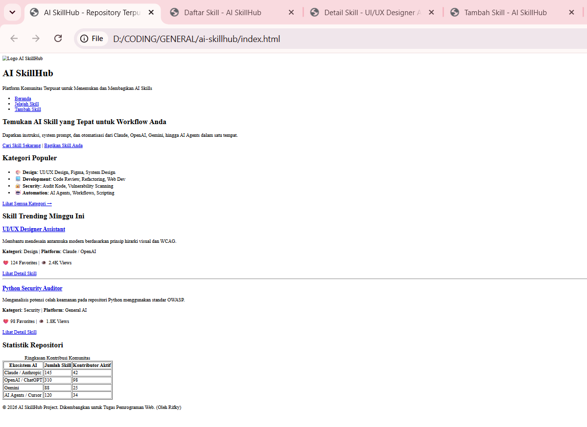 | 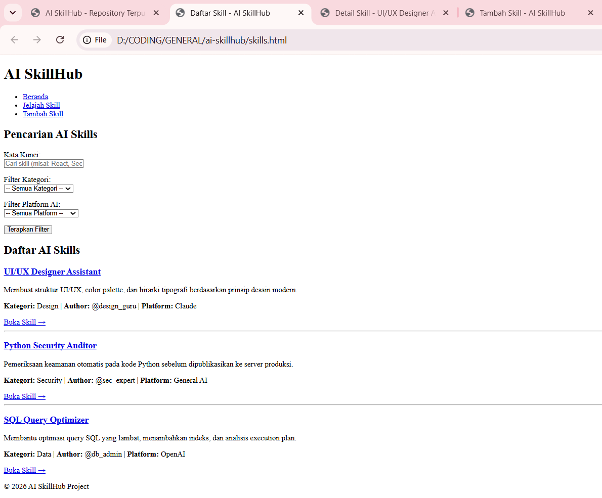 |

| Detail Skill | Form Submit |
|---|---|
| 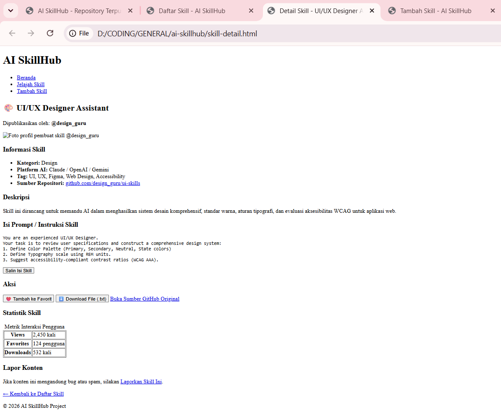 | 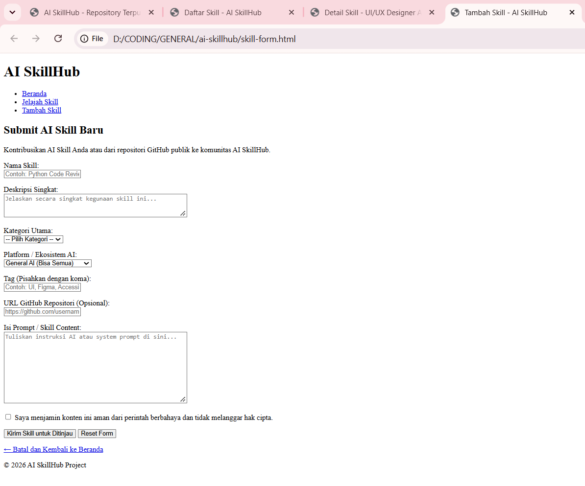 |

</details>

### Minggu 3: Styling dengan CSS

Seluruh halaman terhubung ke satu external stylesheet: `<link rel="stylesheet" href="css/style.css">`.

| Requirement | Penerapan |
|---|---|
| Font | `font-family` Geist, `font-size` 12–30px, `font-weight` 400/500/600 untuk judul dan isi |
| List | Navigasi tanpa bullet (horizontal), kategori dalam grid, daftar info dengan bullet |
| Text-align | Hero, judul form, footer, dan isi tabel rata tengah; caption tabel rata kiri |
| Warna | Tema gelap dengan token warna di `:root` |
| Div & Span | `div.brand`, `div.hero-actions`, `div.actions`, `div.form-group`, `div.form-header`, `span.badge`, `span.author` |
| Responsive | `@media (max-width: 768px)`: navigasi horizontal → vertikal, kategori 4 → 2 kolom, form pencarian dan layout detail menjadi 1 kolom |

Tambahan aksesibilitas:

- `:focus-visible` memberi garis putih pada elemen yang sedang difokus dengan keyboard.
- `aria-current="page"` menandai halaman aktif di navigasi.
- Tombol memiliki state hover, active, dan disabled.
- Label tombol deskriptif, misalnya "Salin Skill" dan "Buka di GitHub".

---

## Screenshot Desktop vs Mobile

| Halaman | Desktop (1280px) | Mobile (390px) |
|---|---|---|
| Beranda | 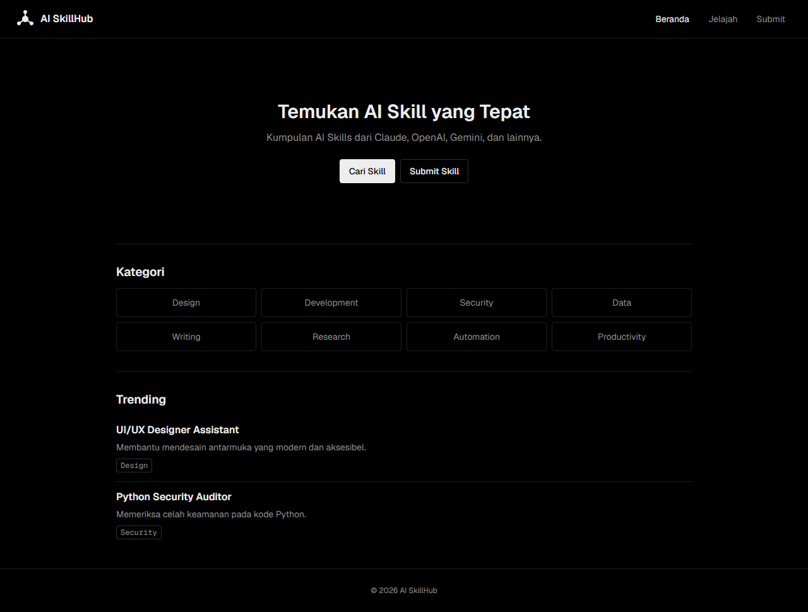 | 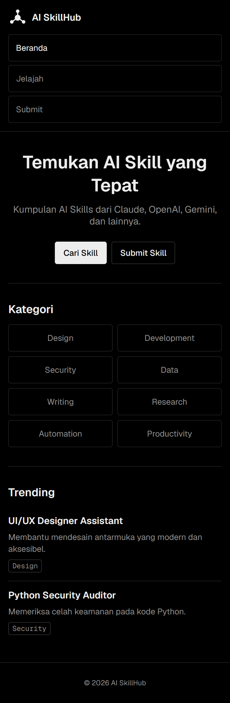 |
| Jelajah Skill | 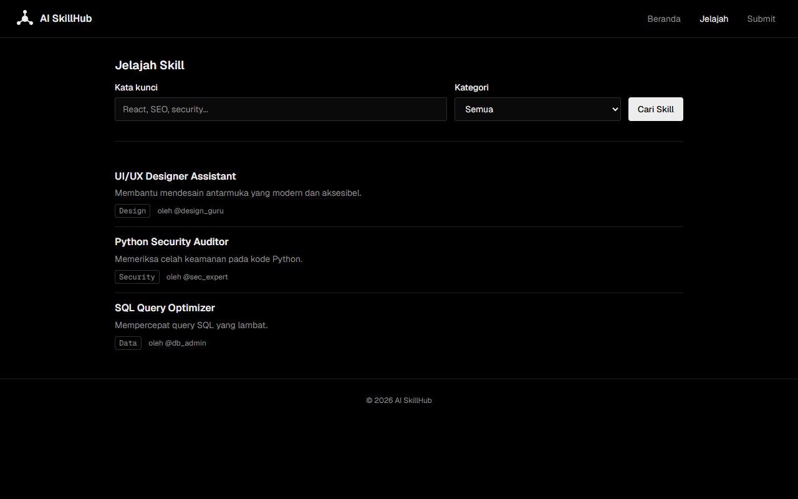 | 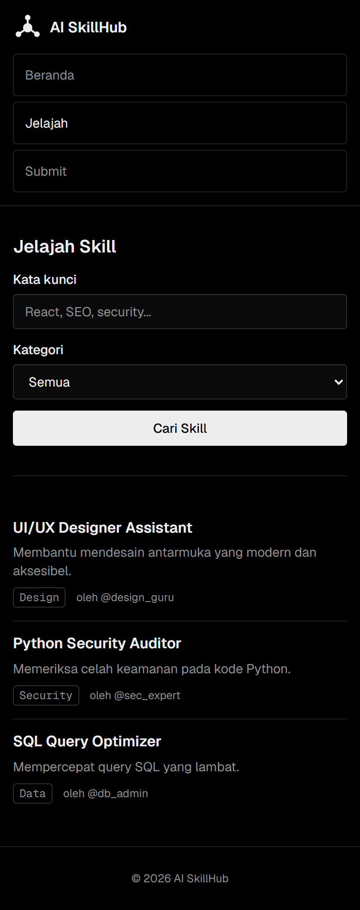 |
| Detail Skill | 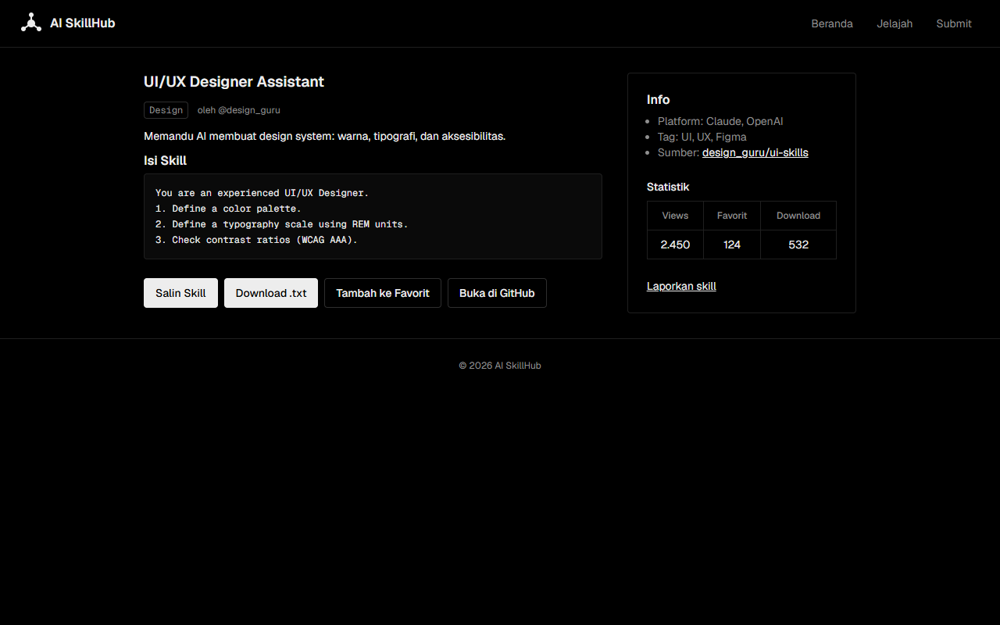 | 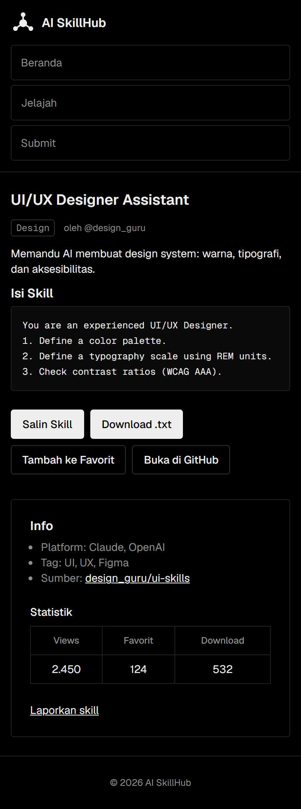 |
| Form Submit | 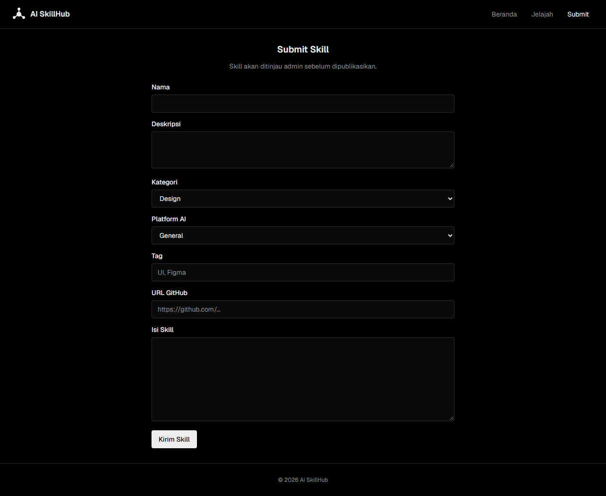 | 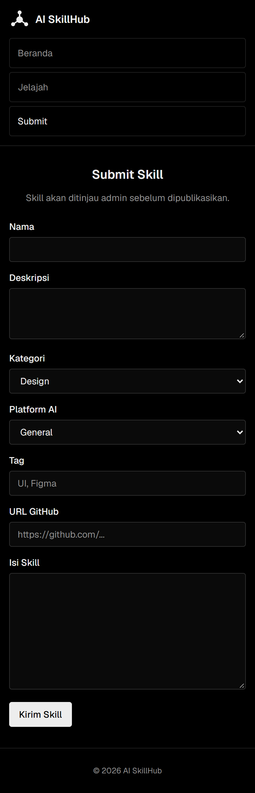 |
