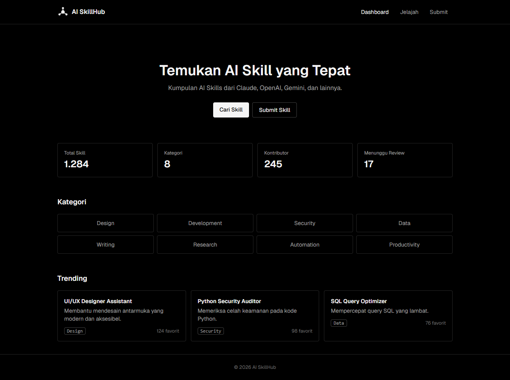
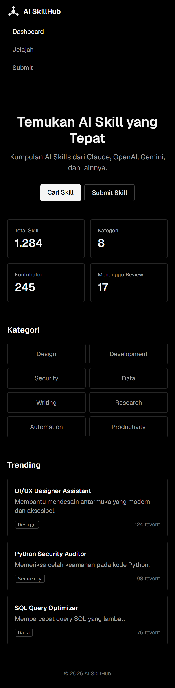
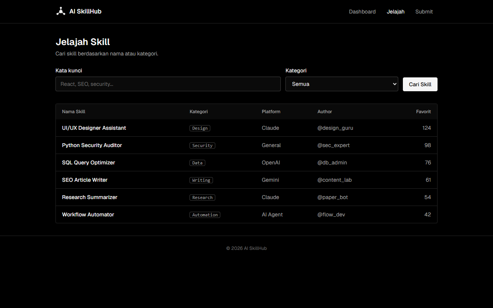
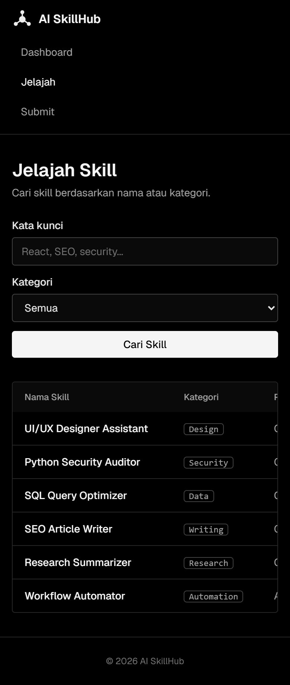
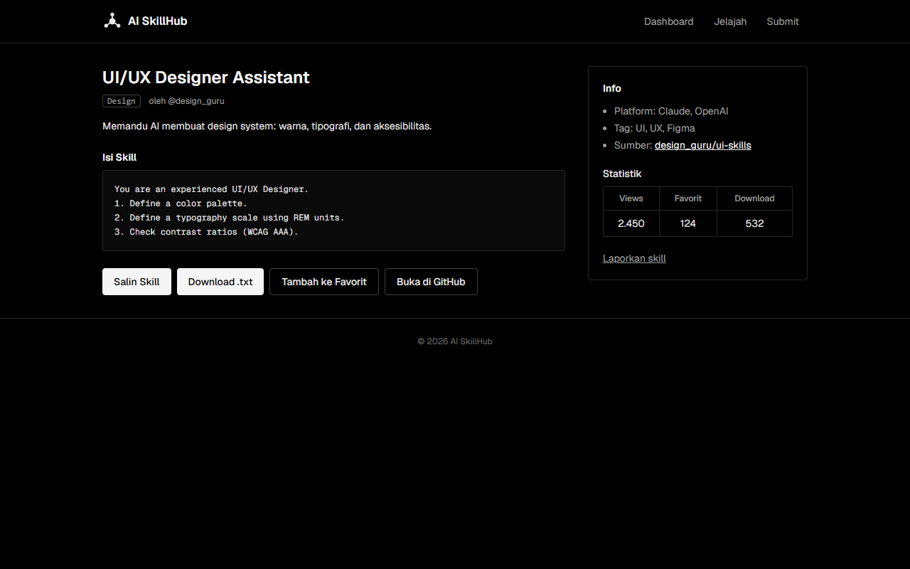
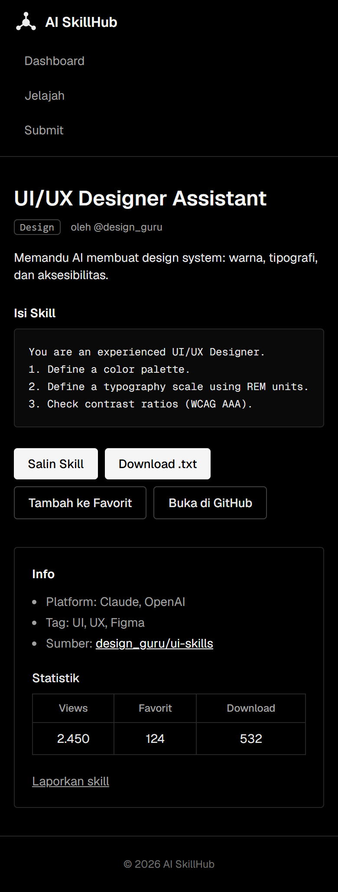
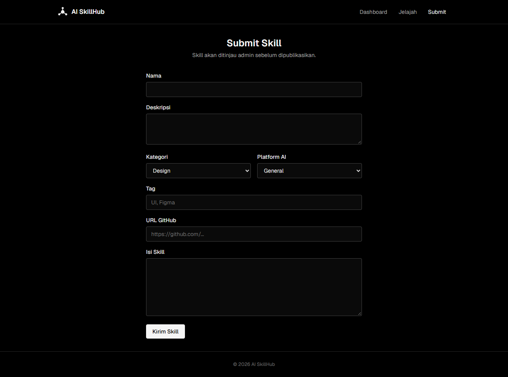
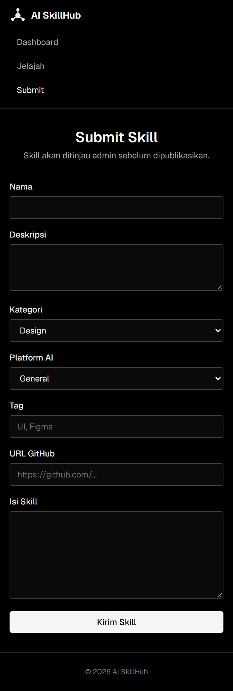

# AI SkillHub

**Nama:** Rifky Albuchori  
**NIM:** 103022400126  
**Kelas:** SE-48-04  
**Studi Kasus:** AI SkillHub (Community-driven AI Skills Repository)

---

## Deskripsi

AI SkillHub adalah aplikasi web untuk menemukan, menyimpan, dan membagikan *AI Skills* dari berbagai ekosistem AI (Claude, OpenAI, Gemini, hingga AI Agents). Pengguna dapat mencari skill, membaca isinya, lalu menyalin atau membuka sumber aslinya di GitHub. Pengguna juga dapat mengirim skill sendiri yang akan ditinjau admin sebelum dipublikasikan.

Alur utama: **Cari → Pahami → Salin/Download → Gunakan**

Proyek ini dibangun bertahap hingga pekan ke-14 menjadi aplikasi fullstack.

---

## Halaman

| File | Halaman | Isi |
|---|---|---|
| `index.html` | Dashboard | Hero, kartu statistik, grid kategori, skill trending |
| `skills.html` | Jelajah Skill | Form pencarian dan tabel daftar skill |
| `skill-detail.html` | Detail Skill | Isi skill, tombol aksi, info, dan statistik |
| `skill-form.html` | Submit Skill | Form untuk mengirim skill baru |

---

## Teknologi

- HTML5 (semantic)
- [Tailwind CSS v4](https://tailwindcss.com/) melalui CDN (tanpa JavaScript tambahan)
- Font [Geist](https://fonts.google.com/specimen/Geist) dari Google Fonts

## Struktur Folder

```
ai-skillhub/
├── index.html
├── skills.html
├── skill-detail.html
├── skill-form.html
├── assets/
│   └── images/
│       └── logo.svg
└── docs/
    └── screenshots/
        ├── minggu-2/
        ├── minggu-3/
        └── minggu-4/
```

## Cara Menjalankan

1. Clone repository ini.
2. Buka `index.html` di browser.

> Tailwind CSS dan font Geist dimuat dari internet, jadi pastikan perangkat terhubung ke internet.

---

## Desain

Tampilan memakai gaya **gelap dan minimalis**: latar hitam, teks abu-abu terang, garis tipis sebagai pemisah, tanpa emoji, dan teks singkat.

| Elemen | Class Tailwind |
|---|---|
| Latar halaman | `bg-black` |
| Teks utama / judul | `text-neutral-200` / `text-neutral-100` |
| Teks pendukung | `text-neutral-400` |
| Garis & kartu | `border border-neutral-800 rounded` |
| Input | `bg-neutral-950 border-neutral-700` |
| Tombol utama | `bg-neutral-100 text-black` |
| Tombol kedua | `border border-neutral-700` |

### Logo

Logo berbentuk **hub**: satu titik pusat yang terhubung ke tiga titik, melambangkan tempat berkumpulnya skill dari berbagai sumber. Dibuat sebagai SVG (`assets/images/logo.svg`) sehingga tetap tajam di semua ukuran, dan juga dipakai sebagai favicon.

---

## Progres Tugas

### Minggu 2: Struktur HTML Murni

- **Semantic HTML5:** `<header>`, `<nav>`, `<main>`, `<section>`, `<article>`, `<aside>`, `<footer>`.
- **Aksesibilitas:** gambar memiliki atribut `alt` dan setiap input terhubung dengan `<label for="...">`.
- **Tabel:** `<table>`, `<caption>`, `<thead>`, `<tbody>`.

<details>
<summary>Screenshot Minggu 2 (HTML tanpa CSS)</summary>

| Beranda | Jelajah Skill |
|---|---|
|  |  |

| Detail Skill | Form Submit |
|---|---|
|  |  |

</details>

### Minggu 3: Styling dengan CSS

Seluruh halaman dihubungkan ke satu external stylesheet `style.css` yang berisi font, styling list, `text-align`, warna sebagai variabel di `:root`, `<div>`/`<span>` untuk komponen, dan `@media (max-width: 768px)` untuk navigasi vertikal di mobile.

Pada Minggu 4, `style.css` digantikan oleh Tailwind CSS. Kode CSS Minggu 3 tetap dapat dilihat di histori commit.

<details>
<summary>Screenshot Minggu 3 (Desktop vs Mobile)</summary>

| Halaman | Desktop | Mobile |
|---|---|---|
| Beranda |  |  |
| Jelajah Skill |  |  |
| Detail Skill |  |  |
| Form Submit |  |  |

</details>

### Minggu 4: Frontend Skeleton dengan Tailwind CSS

| Requirement | Penerapan |
|---|---|
| Halaman utama dengan layout grid | `index.html`: statistik `grid-cols-2 md:grid-cols-4`, kategori `grid-cols-2 md:grid-cols-4`, trending `md:grid-cols-3` |
| Halaman tabel/daftar data | `skills.html`: tabel skill dengan `overflow-x-auto` agar bisa digeser di layar kecil |
| Halaman form | `skill-form.html`: form submit skill, kategori dan platform berdampingan dengan `sm:grid-cols-2` |
| Navigasi responsif | Navbar dengan `flex-col md:flex-row`: link tersusun vertikal di mobile dan horizontal di desktop, tanpa JavaScript |

#### Alasan Memilih Tailwind CSS

1. **Sesuai rencana stack:** aplikasi akan dikembangkan dengan Next.js, dan Tailwind adalah pasangan yang umum dipakai di ekosistem tersebut. Class yang ditulis sekarang bisa langsung dipindahkan ke komponen nanti.
2. **Desain sendiri, bukan template:** AI SkillHub memakai tema gelap minimalis yang khas. Tailwind memberi utility kecil (warna, jarak, border) untuk menyusun tampilan sendiri, sedangkan Bootstrap cenderung menghasilkan tampilan bawaan yang perlu banyak di-override.
3. **Responsif lebih mudah:** prefix seperti `md:` dan `sm:` langsung di class HTML membuat perubahan layout mobile ke desktop terlihat jelas di satu tempat.
4. **Banyak komponen berulang:** kartu skill, badge kategori, dan baris tabel memakai pola class yang sama, sehingga tampilannya konsisten di semua halaman.

#### Screenshot Desktop vs Mobile

| Halaman | Desktop (1280px) | Mobile (390px) |
|---|---|---|
| Dashboard |  |  |
| Jelajah Skill (tabel) |  |  |
| Detail Skill |  |  |
| Form Submit |  |  |
